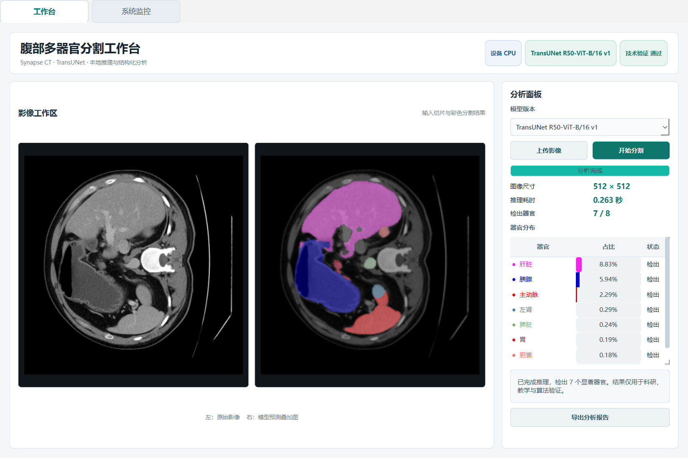
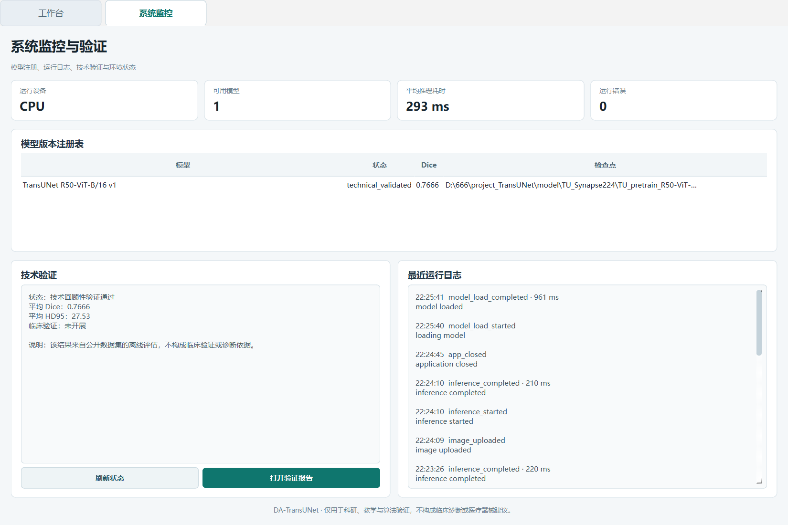
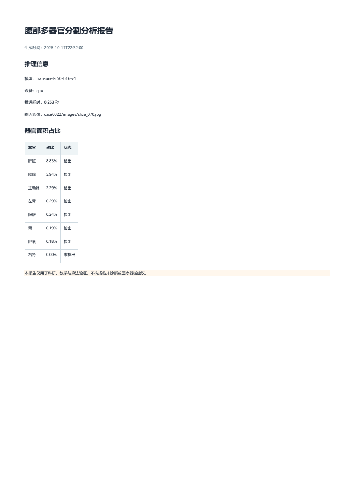
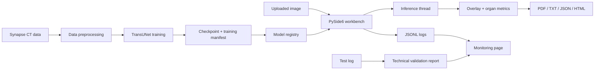

# DA-TransUNet

**Abdominal Multi-Organ Segmentation Workbench**

[](https://github.com/zhang888-bit/DA-TransUNet/actions/workflows/ci.yml)


DA-TransUNet is a research and educational workbench for abdominal multi-organ
segmentation on the Synapse CT dataset. It combines a hybrid CNN-Transformer
segmentation model, training and 3D evaluation tools, a desktop inference
interface, model version management, structured monitoring, automated tests,
and retrospective technical validation reports.

> This project is not a medical device and must not be used for diagnosis,
treatment, or clinical decision-making.



## Highlights

- Hybrid ResNet50 + Vision Transformer segmentation network.
- Nine-class abdominal CT segmentation: background and eight organs.
- Training, 3D volume evaluation, Dice, and HD95 workflows.
- PySide6 desktop workbench with asynchronous inference.
- Model registry with checkpoint SHA256 and validation linkage.
- JSONL logging and a system-monitoring page.
- Automated reports in PDF, TXT, JSON, and HTML.
- Retrospective technical validation report with explicit clinical-use boundaries.
- 13 standard-library automated tests.
- Shared PyCharm run configurations.

## Interface

| Segmentation Workbench | System Monitoring |
| --- | --- |
|  |  |

Example PDF report:



## Architecture



## Project Structure

```text
.
├── TransUNet/
│   ├── app_logging.py
│   ├── clinical_validation.py
│   ├── configs/model_registry.json
│   ├── datasets/
│   ├── docs/
│   ├── model_registry.py
│   ├── monitoring.py
│   ├── networks/
│   ├── report_export.py
│   ├── tests/
│   ├── train.py
│   ├── trainer.py
│   ├── test.py
│   └── ui.py
├── docs/
├── .github/workflows/ci.yml
├── requirements-ci.txt
└── README.md
```

The repository intentionally excludes datasets, checkpoints, prediction
folders, runtime logs, and generated overlay images.

## Quick Start

### 1. Environment

Python 3.10 or newer is recommended.

```bash
python -m venv .venv
```

Activate the environment and install dependencies:

```bash
python -m pip install --upgrade pip
python -m pip install -r TransUNet/requirements.txt
```

### 2. Data

Prepare Synapse according to
[`TransUNet/datasets/README.md`](TransUNet/datasets/README.md).

Expected locations:

```text
data/Synapse/train_npz/
data/Synapse/test_vol_h5/
```

Data is not redistributed by this repository. Follow the original dataset
license and access requirements.

### 3. Checkpoint

Place a compatible checkpoint in the registered location:

```text
model/TU_Synapse224/TU_pretrain_R50-ViT-B_16_skip3_bs24_224/epoch_149.pth
```

Large checkpoints are not committed to Git. To register another checkpoint:

```bash
python TransUNet/model_registry.py register \
  --id transunet-candidate \
  --display-name "TransUNet candidate" \
  --checkpoint path/to/checkpoint.pth \
  --status candidate
```

List registered models:

```bash
python TransUNet/model_registry.py list
```

### 4. Run the Desktop Workbench

```bash
python TransUNet/ui.py --device auto
```

The UI supports:

- model selection from the registry
- background inference
- original and overlay image comparison
- per-organ area percentages
- runtime monitoring
- report export

## Training and Evaluation

Train:

```bash
python TransUNet/train.py \
  --dataset Synapse \
  --vit_name R50-ViT-B_16 \
  --device auto
```

Evaluate 3D volumes:

```bash
python TransUNet/test.py \
  --dataset Synapse \
  --vit_name R50-ViT-B_16 \
  --device auto
```

GPU is strongly recommended for full training. CPU inference is supported.

## Tests

```bash
python TransUNet/run_tests.py
```

The suite covers:

- registry loading and registration
- checkpoint metadata and paths
- metric edge cases
- technical validation reports
- JSONL logging and monitoring
- PDF/TXT/JSON/HTML report generation

Tests that require the large local checkpoint skip automatically when it is not
present, allowing CI to run on a clean public clone.

## Technical Validation

Generate the retrospective technical validation report:

```bash
python TransUNet/clinical_validation.py
```

Outputs:

- `TransUNet/validation/validation_report.json`
- `TransUNet/validation/validation_report.html`

The local report records Mean Dice `0.7666` and Mean HD95 `27.53` on the
available Synapse test log. This is **retrospective technical validation**, not
a clinical trial. The report explicitly uses:

```text
report_type: technical_retrospective_validation
clinical_validation_status: not_performed
intended_use: research_education_only
```

No diagnostic safety, clinical efficacy, external-site generalization, reader
study, or regulatory approval is claimed.

## Model and Run Management

- `TransUNet/configs/model_registry.json`: registered model versions and metrics.
- `logs/application.jsonl`: structured runtime events with rotation.
- `training_manifest.json`: generated in each training snapshot directory.
- PyCharm shared configurations are stored in `.run/`.

## PyCharm

Shared run configurations include:

- UI - Synapse
- UI Smoke - Synapse
- Test - Synapse
- Train - Synapse
- Validation - Synapse
- Model Registry
- Tests - Automated

## Reproduction

See [`docs/REPRODUCTION.md`](docs/REPRODUCTION.md) for setup and checkpoint
instructions and [`docs/ARCHITECTURE.md`](docs/ARCHITECTURE.md) for component
boundaries.

## Limitations

- Only the public Synapse research dataset is used in the available validation.
- No prospective clinical study or external-site validation has been performed.
- Class imbalance and small-organ errors remain important failure modes.
- Full training requires substantial GPU resources.
- The desktop UI is optimized for single-slice demonstration and analysis.
- The repository does not redistribute restricted data or large checkpoints.

## Contributing

See [`CONTRIBUTING.md`](CONTRIBUTING.md). Do not submit patient data, private
DICOM files, model weights, secrets, or generated runtime artifacts.

## Citation

If you use this software, cite the original TransUNet paper:

```bibtex
@article{chen2021transunet,
  title={TransUNet: Transformers Make Strong Encoders for Medical Image Segmentation},
  author={Chen, Jieneng and Lu, Yongyi and Yu, Qihang and Luo, Xiangde and Adeli, Ehsan and Wang, Yan and Lu, Le and Yuille, Alan L. and Zhou, Yuyin},
  journal={arXiv preprint arXiv:2102.0436},
  year={2021}
}
```

Repository citation metadata is available in [`CITATION.cff`](CITATION.cff).

## License

Apache License 2.0. See [`LICENSE`](LICENSE) and [`NOTICE`](NOTICE).

## Acknowledgements

- [TransUNet](https://github.com/Beckschen/TransUNet)
- [Google Vision Transformer](https://github.com/google-research/vision_transformer)
- [ViT-PyTorch](https://github.com/jeonsworld/ViT-pytorch)
- [segmentation_models.pytorch](https://github.com/qubvel/segmentation_models.pytorch)
